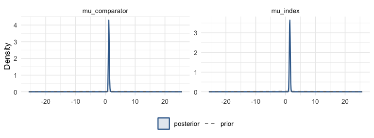
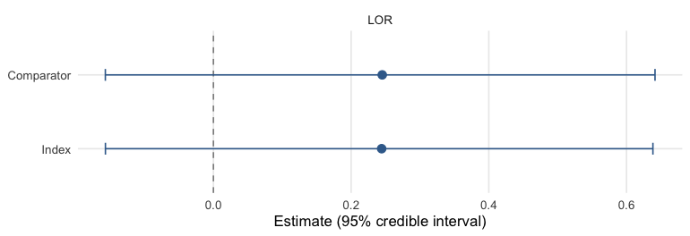
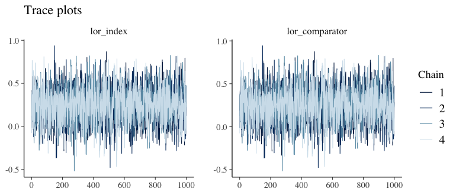

``` r
library(mlumr)
library(ggplot2)
options(mc.cores = parallel::detectCores())
```

This vignette covers the mechanics of fitting an ML-UMR model with `mlumr()`:
sampler control, backends, priors, inspecting a fit, and MCMC diagnostics. It is
family-agnostic, we illustrate with the real plaque-psoriasis binary example
from `vignette("binary-outcomes")`, but the workflow is identical for
continuous, count, and survival outcomes. For *which* method to report, see
`vignette("choosing-a-method")`.

`mlumr()` fits two model variants by Stan: `model = "spfa"` (shared
prognostic-factor coefficients) and `model = "relaxed"` (treatment-specific
coefficients, allowing effect modification). The default backend is `rstan`;
`cmdstanr` is an optional alternative. The sampler messages, timings and
`Engine:` line shown throughout this vignette were produced with `cmdstanr`,
which `vignettes/precompile.R` selects, so running the same code with the
defaults prints rstan's equivalents instead.

## A model to work with

We reuse the plaque-psoriasis binary example, a compact ML-UMR fit that the rest
of this vignette inspects, tunes, and diagnoses (the data preparation is covered
in `vignette("binary-outcomes")`).

> **Hypothetical single-arm trials.** UNCOVER-2 and FIXTURE are randomized
> trials. Dropping their common reference arms (placebo and etanercept) turns
> them into hypothetical single-arm trials and leaves fully disconnected
> evidence; we do this only to illustrate ML-UMR. In practice, randomized
> trials should never be analyzed this way: ML-NMR (for example with
> `multinma`) or another appropriate method should be used for them. ML-UMR
> should only be used for fully unanchored, single-arm comparisons.


``` r
data("psoriasis_ipd")   # bundled with mlumr (from multinma, GPL-3)
data("psoriasis_agd")

covs <- c("age", "bsa", "weight")
ipd <- psoriasis_ipd
ipd$bsa <- ipd$bsa / 100          # body-surface area: % -> proportion
ipd <- ipd[ipd$study == "UNCOVER-2" & ipd$treatment == "IXE_Q4W", ]
ipd <- ipd[stats::complete.cases(ipd[, c("pasi75", covs)]), ]

agd <- psoriasis_agd
agd$bsa_mean <- agd$bsa_mean / 100; agd$bsa_sd <- agd$bsa_sd / 100
agd <- agd[agd$study == "FIXTURE" & agd$treatment == "SEC_300", ]

dat <- combine_data(
  set_ipd(ipd, treatment = "treatment", outcome = "pasi75", covariates = covs),
  set_agd(agd, treatment = "treatment", outcome_n = "pasi75_n", outcome_r = "pasi75_r",
          cov_means = c("age_mean", "bsa_mean", "weight_mean"),
          cov_sds   = c("age_sd", "bsa_sd", "weight_sd"),
          cov_types = c("continuous", "continuous", "continuous")))
dat <- add_integration(dat, n_int = 64,
  age    = distr(qgamma,     mean = age_mean,    sd = age_sd),
  bsa    = distr(qlogitnorm, mean = bsa_mean,    sd = bsa_sd),
  weight = distr(qgamma,     mean = weight_mean, sd = weight_sd))

fit <- mlumr(dat, model = "spfa",
             prior_beta = prior_normal(0, 2.5, autoscale = TRUE),
             chains = 4, iter = 2000, warmup = 1000, seed = 2026, refresh = 0)
#> Running MCMC with 4 parallel chains...
#> 
#> Chain 2 finished in 1.4 seconds.
#> Chain 3 finished in 1.4 seconds.
#> Chain 1 finished in 1.7 seconds.
#> Chain 4 finished in 1.5 seconds.
#> 
#> All 4 chains finished successfully.
#> Mean chain execution time: 1.5 seconds.
#> Total execution time: 1.9 seconds.
```

## Controlling the sampler

All sampler controls are arguments to `mlumr()`. For a production analysis use
more chains and iterations than the short settings above:


``` r
fit <- mlumr(
  dat, model = "spfa",
  chains = 4,            # number of MCMC chains
  iter = 4000,           # total iterations per chain
  warmup = 2000,         # warmup iterations
  seed = 2026,           # reproducibility
  adapt_delta = 0.99,    # raise toward 1 to remove divergences
  max_treedepth = 15,    # raise if treedepth is saturated
  refresh = 500          # progress printing (0 = silent)
)
```

## Backend selection

`rstan` (default) uses the model compiled into the installed package.
`cmdstanr` is an optional backend, selected per fit or globally with
`mlumr_engine("cmdstanr")`:


``` r
fit_cmd <- mlumr(dat, model = "spfa", engine = "cmdstanr", seed = 2026, refresh = 0)
```

`cmdstanr` is often faster once compiled, especially with parallel chains and
long runs. Posterior estimates agree up to Monte Carlo error.

## Priors

The defaults, `prior_normal(0, 10)` for intercepts and
`prior_normal(0, 2.5)` for regression coefficients, are generic starting
values rather than calibrated choices for every family and outcome scale.
**Autoscaling** divides a coefficient prior's location and scale by each
covariate's SD so its intended contribution is preserved when predictors use
different units. For `family = "normal"` the intercepts, the identity-link
coefficients and the residual SD are in the outcome's own units, so there the
defaults and autoscaled scales are also multiplied by the IPD outcome SD (see
`vignette("continuous-outcomes")`). Inspect the priors actually passed to
Stan, including autoscaled scales, with `prior_summary()`:


``` r
prior_summary(fit)
#> Priors for ML-UMR Fit
#> =====================
#> 
#> Intercepts (mu_index, mu_comparator):
#>   normal(0, 10)
#>   (package default, mlumr 0.2.0)
#> 
#> Regression coefficients (beta):
#>   Family: normal
#>  coefficient mean  scale autoscaled   sd_x
#>          age    0  0.196       TRUE 12.784
#>          bsa    0 14.055       TRUE  0.178
#>       weight    0  0.120       TRUE 20.794
#>   (scale = user_scale / sd_x for autoscaled rows)
```

Overlaying the prior on the posterior shows how much the data have updated each
parameter, the intercepts move sharply away from their $\mathrm{N}(0,10)$ prior:


``` r
plot_prior_posterior(fit, pars = c("mu_index", "mu_comparator"))
```

<div class="figure" style="text-align: center">

<p class="caption">plot of chunk prior-post</p>
</div>

## Inspecting a fit

`print()` gives a one-line description of the model; `summary()` tabulates the
posterior for every parameter (point estimate, credible interval, and the
per-parameter convergence diagnostics):


``` r
print(fit)
#> ML-UMR Fit
#> ==========
#> 
#> Model: SPFA (Shared Prognostic Factors) 
#> Family: Binary 
#> Link: logit 
#> Engine: cmdstanr 
#> Treatments:
#>   Index (IPD): IXE_Q4W 
#>   Comparator (AgD): SEC_300 
#> 
#> Data:
#>   IPD: n = 345 observations
#>   AgD: 1 rows
#>   Covariates: 3 
#>   Integration points: 64 
#> 
#> Sampling:
#>   Chains: 4 
#>   Iterations: 2000 (warmup: 1000 )
#> 
#> Key Parameters:
#>        variable       mean         sd        2.5%     97.5%      Rhat
#>        mu_index 1.43837824 0.15481928  1.14502551 1.7400851 1.0006678
#>   mu_comparator 1.17475314 0.14944520  0.89090936 1.4798617 1.0014834
#>       lor_index 0.24434744 0.20173326 -0.15686507 0.6383660 0.9999245
#>  lor_comparator 0.24519725 0.20256459 -0.15698170 0.6414068 0.9999288
#>        rd_index 0.04595258 0.03803838 -0.02806199 0.1213993 0.9998960
#>   rd_comparator 0.04007462 0.03306184 -0.02574983 0.1042112 1.0000155
#> 
#> Use summary() for full results
summary(fit)
#> ML-UMR Model Summary
#> ====================
#> 
#> Model: SPFA 
#> Family: Binary 
#> Link: logit 
#> Engine: cmdstanr 
#> Treatments: IXE_Q4W (IPD) vs SEC_300 (AgD)
#> 
#> MCMC Diagnostics:
#>   Divergent transitions: 0 
#>   Max treedepth hits: 0 
#>   Max Rhat: 1.007  
#>   Min ESS: 1833  
#> 
#> Intercepts (logit scale):
#>       variable     mean        sd      2.5%    97.5%     Rhat
#>       mu_index 1.438378 0.1548193 1.1450255 1.740085 1.000668
#>  mu_comparator 1.174753 0.1494452 0.8909094 1.479862 1.001483
#> 
#> Regression Coefficients:
#>      variable        mean          sd        2.5%        97.5%     Rhat
#>     beta[age] -0.04065884 0.011134813 -0.06286905 -0.019349026 1.004234
#>     beta[bsa]  0.11284271 0.744117466 -1.29112756  1.628902988 1.001230
#>  beta[weight] -0.01435090 0.006465275 -0.02696024 -0.002018735 1.001522
#> 
#> Marginal Treatment Effects:
#>   Log Odds Ratios:
#>        variable      mean        sd       2.5%     97.5%
#>       lor_index 0.2443474 0.2017333 -0.1568651 0.6383660
#>  lor_comparator 0.2451973 0.2025646 -0.1569817 0.6414068
#>   Risk Differences:
#>       variable       mean         sd        2.5%     97.5%
#>       rd_index 0.04595258 0.03803838 -0.02806199 0.1213993
#>  rd_comparator 0.04007462 0.03306184 -0.02574983 0.1042112
#>   Risk Ratios:
#>       variable     mean         sd      2.5%    97.5%
#>       rr_index 1.065151 0.05505573 0.9636241 1.181185
#>  rr_comparator 1.052972 0.04420995 0.9677664 1.141703
```

Population-averaged effects, absolute predictions, and the raw posterior draws
are available from `marginal_effects()` and `predict()` (the available measures
and prediction types depend on the family, see the per-outcome vignettes):


``` r
knitr::kable(marginal_effects(fit, effect = "lor"), caption = "Marginal log odds ratios")
```


Table: Marginal log odds ratios

|variable       |effect |population |      mean|        sd|       q2.5|       q50|     q97.5|
|:--------------|:------|:----------|---------:|---------:|----------:|---------:|---------:|
|lor_index      |LOR    |Index      | 0.2443474| 0.2017333| -0.1568651| 0.2450688| 0.6383660|
|lor_comparator |LOR    |Comparator | 0.2451973| 0.2025646| -0.1569817| 0.2455176| 0.6414068|


Both return **both** target populations by default, the index and the
comparator, which is what separates ML-UMR from the frequentist benchmarks:


``` r
knitr::kable(predict(fit, type = "response"),
   caption = "Standardized response probabilities, both populations")
```


Table: Standardized response probabilities, both populations

|treatment |population |      mean|        sd|      q2.5|       q50|     q97.5|
|:---------|:----------|---------:|---------:|---------:|---------:|---------:|
|IXE_Q4W   |Index      | 0.7734502| 0.0217468| 0.7296282| 0.7740340| 0.8138921|
|SEC_300   |Index      | 0.7274976| 0.0313809| 0.6617943| 0.7277764| 0.7875637|
|IXE_Q4W   |Comparator | 0.8108492| 0.0233590| 0.7631389| 0.8118225| 0.8531969|
|SEC_300   |Comparator | 0.7707746| 0.0235213| 0.7237811| 0.7711268| 0.8160376|


## MCMC diagnostics

`mlumr()` automatically warns about divergent transitions, treedepth
saturation, high Rhat (> 1.01), and low ESS (< 400). Inspect them directly:


``` r
fit$diagnostics$n_divergent
#> [1] 0
fit$diagnostics$n_max_treedepth
#> [1] 0
max(fit$summary$Rhat, na.rm = TRUE)
#> [1] 1.007061
min(fit$summary$n_eff, na.rm = TRUE)
#> [1] 1833.489
```

Posterior intervals for the key effects come straight from `marginal_effects()`
and its `plot()` method:


``` r
plot(marginal_effects(fit, effect = "lor"))
```

<div class="figure" style="text-align: center">

<p class="caption">plot of chunk intervals</p>
</div>

For convergence diagnostics on the raw draws, `bayesplot` needs to know which
chain each draw came from. `fit$draws` is a flat data frame with the chains
already stacked, so passing it directly draws one merged line per parameter.
That looks like a healthy trace whatever the chains did, because the thing a
trace plot exists to show, whether the chains agree with each other, has been
averaged away before plotting. The per-draw chain labels are kept beside the
draws in `fit$chain_ids`, so reshape into the iteration by chain by parameter
array `bayesplot` expects:


``` r
pars <- c("lor_index", "lor_comparator")
chain <- fit$chain_ids
# NULL means the backend could not label the draws, which is itself worth
# knowing: without labels there is no chain comparison to draw.
stopifnot(!is.null(chain))

# `split()` keeps each chain's draws in iteration order, which is what a trace
# needs. Indexing by a chain's own label rather than by arithmetic on the row
# count avoids assuming the chains are equal length or stored in order.
rows_by_chain <- split(seq_along(chain), chain)
n_iter <- unique(lengths(rows_by_chain))
stopifnot(length(n_iter) == 1L)

draws_array <- array(
  NA_real_,
  dim = c(n_iter, length(rows_by_chain), length(pars)),
  dimnames = list(NULL, paste("chain", names(rows_by_chain)), pars)
)
for (k in seq_along(rows_by_chain)) {
  draws_array[, k, ] <- as.matrix(fit$draws[rows_by_chain[[k]], pars])
}

bayesplot::mcmc_trace(draws_array) +
  ggplot2::labs(title = "Trace plots")
```

<div class="figure" style="text-align: center">

<p class="caption">plot of chunk trace</p>
</div>

Each chain is drawn separately, which is what makes the plot readable as a
diagnostic: chains that settled in different places show up as separated bands.
`check_diagnostics()` answers the same question numerically through split-Rhat
and effective sample size, and the two should agree.

## Prior sensitivity

`prior_sensitivity()` refits across a grid of `prior_beta` scales, holding every
other model setting fixed, so any movement in the summaries is attributable to
the prior alone. The fit used here is the SPFA model built above, where the
coefficients are identified by the IPD and the sweep is expected to be flat:


``` r
prior_sensitivity(fit, prior_beta_scales = c(1, 2.5, 5))
#> Running MCMC with 4 parallel chains...
#> 
#> Chain 2 finished in 1.7 seconds.
#> Chain 3 finished in 1.6 seconds.
#> Chain 1 finished in 1.9 seconds.
#> Chain 4 finished in 1.6 seconds.
#> 
#> All 4 chains finished successfully.
#> Mean chain execution time: 1.7 seconds.
#> Total execution time: 2.0 seconds.
#> Running MCMC with 4 parallel chains...
#> 
#> Chain 2 finished in 1.6 seconds.
#> Chain 1 finished in 1.9 seconds.
#> Chain 3 finished in 1.8 seconds.
#> Chain 4 finished in 1.8 seconds.
#> 
#> All 4 chains finished successfully.
#> Mean chain execution time: 1.8 seconds.
#> Total execution time: 2.1 seconds.
#> Running MCMC with 4 parallel chains...
#> 
#> Chain 1 finished in 1.4 seconds.
#> Chain 2 finished in 1.4 seconds.
#> Chain 3 finished in 1.3 seconds.
#> Chain 4 finished in 1.1 seconds.
#> 
#> All 4 chains finished successfully.
#> Mean chain execution time: 1.3 seconds.
#> Total execution time: 1.5 seconds.
#> 
#> Prior sensitivity: posterior of marginal treatment effects
#> =========================================================
#> 
#>  scale      parameter effect      mean        sd       q2.5       q50     q97.5
#>    1.0      lor_index    LOR 0.2495980 0.1984060 -0.1473980 0.2546824 0.6257489
#>    1.0 lor_comparator    LOR 0.2504603 0.1992289 -0.1475431 0.2552387 0.6276360
#>    2.5      lor_index    LOR 0.2443474 0.2017333 -0.1568651 0.2450689 0.6383660
#>    2.5 lor_comparator    LOR 0.2451973 0.2025646 -0.1569817 0.2455177 0.6414068
#>    5.0      lor_index    LOR 0.2461002 0.2041996 -0.1415294 0.2479227 0.6579873
#>    5.0 lor_comparator    LOR 0.2470028 0.2051317 -0.1415307 0.2485980 0.6600727
#> 
#> Interpretation: approximately constant summaries show the posterior
#> is insensitive to the beta-prior SCALES tested here. That is not the
#> same as the inference being data-driven: identification also depends
#> on the prior family and location, the comparator-specific and
#> auxiliary priors, and the model structure. Vary those too. For a
#> non-survival fit, check_identification() adds the geometry of the
#> aggregate rows: exact for a normal identity-link model, descriptive
#> otherwise.
```

The case that motivates the check is the relaxed model, whose comparator
coefficients are informed only through the aggregate likelihood and can
therefore be prior-sensitive. For a relaxed binomial, normal, or poisson fit, run
`check_identification()` on the data first, since a sweep cannot repair a design
that carries no information about a coefficient, then pass the relaxed fit to
`prior_sensitivity()` and sweep the comparator prior alongside the index one
with `prior_beta_comparator_scales`. See
`vignette("subgroup-identification", "mlumr")`. Survival is the exception:
`check_identification()` refuses it, because a reconstructed comparator curve is
not a set of scalar subgroup summaries and a row count neither bounds nor
certifies what it identifies. For a relaxed survival fit, inspect the coefficient
posterior and use the prior sweep. The reported marginal posterior-to-prior
variance change is descriptive and is not a fraction learned from the data.

## Troubleshooting

- **Divergent transitions**, raise `adapt_delta` (e.g. `0.99`).
- **Slow convergence / low ESS**, increase `iter` and `warmup`.
- **Relaxed-model identifiability**, with little AgD, the comparator-specific
  coefficients are weakly identified (mlumr warns). Use SPFA if effect
  modification is not expected, supply more informative `prior_beta`, or run
  `prior_sensitivity()`.

## References
