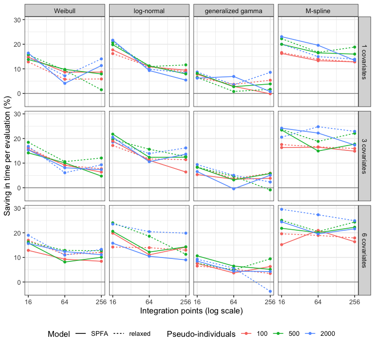

Survival fits spend most of their time on the comparator likelihood. Each
reconstructed comparator pseudo-individual is integrated over the covariate
distribution of the comparator population [@ChandlerIshak2026], so the
comparator contributes one likelihood term per pseudo-individual and
integration point, and the sampler evaluates all of them, with their gradient,
at every leapfrog step.

From version 0.2.1 the survival models compute the comparator linear predictor
once per arm instead of once per pseudo-individual. This *predictor reuse* is
on by default. It changes how the log density is computed, not the model and
not the posterior distribution.

This vignette covers three things:

1. how to turn the optimization off, and when that is useful;
2. what predictor reuse changes in the computation, and why draws can still
   differ in their final digits;
3. a simulation study that compares survival fits with and without the
   optimization, both per evaluation of the log density and in complete fits.

## The `optimization` argument


``` r
library(mlumr)

# Predictor reuse (the default).
fit <- mlumr(dat, distribution = "weibull")
# The computation of releases before 0.2.1.
fit_ref <- mlumr(dat, distribution = "weibull", optimization = FALSE)
```

The setting is stored in the fit as `fit$model_controls$optimization`, and
`prior_sensitivity()` refits the model with the same setting. A fit made with a
release before 0.2.1 records no setting; `prior_sensitivity()` refits it with
`optimization = FALSE`, the computation it used.

In this release the argument affects survival fits only. Binary, continuous,
and count fits ignore it. It is unrelated to Stan's optimization algorithms:
the posterior distribution is always explored by Markov chain Monte Carlo
sampling.

There are two reasons to turn the optimization off:

* to benchmark it, as in the study below;
* to repeat the computation of a release before 0.2.1, so that a fit made with
  such a release can be reproduced exactly. This also requires the same Stan
  version, compiler, and seed.

## What predictor reuse changes

The comparator evidence in a survival fit is reconstructed pseudo-individual
data. The likelihood of each pseudo-individual is integrated over the covariate
distribution of the comparator population, as in the population adjustment of
multilevel network meta-regression [@Phillippo2020]. With integration points
$x_{a1}, \dots, x_{aM}$ for comparator arm $a$, the likelihood contribution of
pseudo-individual $j$, with observed time $t_j$ and event indicator $d_j$, is

$$
L_j = \frac{1}{M} \sum_{m=1}^{M} f\!\left(t_j, d_j \mid \eta_{am}\right),
\qquad
\eta_{am} = \mu_{C} + x_{am}^{\top} \beta,
$$

where $f$ is the density or survival function of the chosen distribution,
$\mu_C$ is the comparator intercept, and $\beta$ is the vector of comparator
covariate coefficients.

The linear predictors $\eta_{a1}, \dots, \eta_{aM}$ depend on the arm and the
parameters but not on $j$. Releases before 0.2.1 nevertheless recomputed them
for every pseudo-individual: one product of the $M \times n_B$ design matrix
with the coefficient vector per pseudo-individual and per evaluation of the log
density, where $n_B$ is the number of design columns. With predictor reuse they
are computed once per arm and evaluation, and shared by all pseudo-individuals
in the arm.

Stan computes the gradient of the log density by reverse-mode automatic
differentiation [@Carpenter2017], and the No-U-Turn sampler [@Hoffman2014]
evaluates this gradient at every leapfrog step. Each matrix-vector product
creates $M$ new values in the expression graph, with the bookkeeping needed to
differentiate them, and in the reverse pass propagates $M$ adjoints into $n_B$
coefficients. Predictor reuse removes all but one product per arm. It leaves
unchanged the $n_{\text{agd}} \times M$ likelihood terms $f$, the likelihood of
the index study, and the priors.

The saving per evaluation is therefore the share of the total cost that the
removed products account for. It should be larger when the design is wider
(more covariates, or the relaxed model with its separate comparator
coefficients) and the likelihood terms are inexpensive. It should be smaller
when the likelihood terms or the index study dominate the cost.

### Same posterior, different final digits

Both computations evaluate the same function. The matrix-vector products give
identical values, but the reverse pass adds up the contributions to each
coefficient's gradient in a different order: once per arm after summing over
pseudo-individuals, instead of once per pseudo-individual. Floating-point
addition is not associative, so the two gradients can differ in their final
digits.

The posterior distribution is the same. Under a common seed the draws coincide
until such differences accumulate along the sampler's trajectory, which can
happen as early as warmup, and they agree in distribution throughout. The
package's parity tests (`tests/parity/` in the source repository) compare, for
each of 52 test cases and both settings, the log density, its gradient, the
parameter transforms, and every generated quantity against the 0.2.0 models.

## Simulation design

The study answers three questions:

1. How much time does predictor reuse save per evaluation of the log density
   and its gradient, the operation repeated at every leapfrog step, and how
   does the saving depend on the distribution, the model, the number of
   comparator pseudo-individuals $n_{\text{agd}}$, the number of integration
   points $M$, and the number of covariates $K$?
2. How much of that saving reaches a complete `mlumr()` fit?
3. Did the computations with and without predictor reuse, and the 0.2.0 models,
   give the same values in every run?

The questions concern computation time and numerical agreement, not bias or
coverage. The script that ran the study is a development file, kept in the
package repository and not installed with the package:
[`data-raw/simulate_survival_optimization.R`](https://github.com/choxos/mlumr/blob/main/data-raw/simulate_survival_optimization.R).
It writes a manifest beside its results recording the software and hardware
used. The numbers below were read from results files with MD5 digests
cdf8546e6f7a093f725259a8dac61d22 (per-evaluation timings) and 654dc369f68c9d2007a96f62d21dfa81 (complete fits); a
package test compares these digests against the files in the repository.

### The data

One data-generating mechanism is used throughout, as a benchmark. Computation
time depends mainly on the code path of the fitted model and on the sample
sizes. It also depends on the data values: through the mix of event and
censoring indicators, through branches of the generalized gamma likelihood that
the values of time and of the parameters select, and, in complete fits, through
the sampler's trajectories. The study does not vary these systematically.

* An index study of 200 individuals and a comparator cohort of
  $n_{\text{agd}}$ individuals are generated in the same way.
* The $K$ covariates alternate between continuous (normal, SD 1) and binary.
  The comparator population is shifted by 0.2 on the continuous covariates and
  has prevalence 0.45, against 0.5 in the index population, on the binary
  covariates.
* Event times follow a Weibull proportional hazards model with shape 1.2,
  coefficients 0.3, -0.2, 0.15, -0.1, 0.25, and -0.15 (the first $K$ of
  these), a baseline median of about five months, and a conditional log hazard
  ratio of -0.4 for the index treatment.
* Censoring times are independent and exponential with rate 0.02 per month,
  with administrative censoring at 24 months: right censoring only, without
  delayed entry.
* The comparator cohort's times and event indicators are supplied to
  `set_agd_surv()` as its pseudo-individual data, with its realized covariate
  means, standard deviations, and proportions. For computation this is
  equivalent to a digitized Kaplan-Meier curve.
* Integration points come from `add_integration()` with its default Gaussian
  copula. The restricted mean survival time (RMST) is computed to 18 months,
  and predictions are made at 6, 12, and 18 months.

Each data set is shared by every distribution and model of the same size, so
those comparisons are made on the same individuals.

### Three computations

* **With predictor reuse** (`optimization = TRUE`): the 0.2.1 survival models,
  which compute the linear predictor once per comparator arm.
* **Without predictor reuse** (`optimization = FALSE`): the same compiled
  models, which recompute the linear predictor for every pseudo-individual.
* **Version 0.2.0**: the survival models as released in mlumr 0.2.0, kept
  unchanged in the repository for the parity tests. They answer two further
  questions: whether 0.2.1 is faster than the previous release, and whether
  the switch between the two computations adds any cost when predictor reuse
  is off.

### Level A: one evaluation at a time

**Workloads.** Every combination of distribution (Weibull, log-normal,
generalized gamma, and the M-spline flexible baseline), model (SPFA and
relaxed), $n_{\text{agd}}$ (100, 500, 2000), $M$ (16, 64, 256), and $K$ (1, 3,
6): 216 workloads, each with two data sets. The piecewise
exponential baseline shares the likelihood code of the M-spline baseline and is
not measured separately.

**Measurement.** Time is measured inside the CmdStan executable that
`mlumr(engine = "cmdstanr")` uses, through CmdStan's `log_prob` method. It reads
a file of parameter values and, for each row, evaluates the log density and its
gradient and writes the result. The CPU time of a run over $N$ rows, minus the
median CPU time of three runs over five rows, divided by $N - 5$, estimates the
cost per row without process start-up, data input, and model construction.
The three short runs are made once per data set and method, so all blocks of a
data set share this subtraction.

The cost per row is one evaluation of the log density and its gradient, plus
reading one row of parameter values and writing one row of results. The reading
and writing are the same for the three computations; they dilute the relative
savings slightly for the least expensive workloads without favoring any of
them. $N$ is chosen per data set so that a run lasts about 0.5 s, with a
minimum of 20 rows, and is the same for all three computations. The
minimum applied to 17% of runs, and the longest
run took 6.1 s of CPU time.

**Parameter values.** The timings use five draws from CmdStan's Laplace
approximation at the posterior mode of each data set, so that they are taken
where the sampler spends its time.
For 67 of the 432 data sets (57 generalized gamma and 10 Weibull) the posterior mode could not be located, and the origin together with four small perturbations of it was used instead.

**Pairing.** Each data set is timed in eight blocks, and each
block runs each of the three computations once. The eight
blocks use the six possible orders once each, plus two further orders that both
begin with predictor reuse, assigned to blocks at random. Predictor reuse
therefore runs first in four of the
eight blocks of every data set, and each of the other
computations in two; every
computation occupies every position. A sensitivity analysis below estimates the
effect of this imbalance. Data sets are processed in random order, so that any
drift in timing over the run is spread across the experimental factors.

**Estimate and interval.** For each block the quantity of interest is the log
ratio of the time per evaluation without predictor reuse to the time with it,
and likewise for the 0.2.0 models. The blocks of a data set share the
subtracted cost of the short runs, so the data set, not the block, is the
independent unit. The estimate for a workload is the mean of its two data-set
means, each the mean of eight block log ratios.

With two data sets per workload, the variance between data-set means cannot be
estimated reliably for each workload on its own. It is pooled over the
18 workloads that share the distribution and the number of
integration points. The two models of a given size are fitted to the same data
sets, so these workloads hold 9 independent pairs of data
sets, and the 95% interval for a workload uses the $t$ distribution with
9 degrees of freedom. Results are reported as the
percentage saving in time per evaluation, $100\,(1 - 1/\text{ratio})$.

### Level B: complete fits

**Scenarios.** Two SPFA scenarios with three covariates and 64 integration
points: a Weibull baseline with 500 comparator pseudo-individuals (ten data
sets) and an M-spline baseline with 300 (five data sets). The smaller number of
M-spline data sets reflects the longer run time of these fits and was fixed
before any fit was run.

**Fits.** Each data set is fitted with `optimization = TRUE` and with
`optimization = FALSE` through `mlumr(engine = "cmdstanr")` with the default
sampler settings (four chains of 2000 iterations, 1000 of them warmup,
`adapt_delta = 0.95`, `max_treedepth = 15`). The four chains run in parallel,
and both fits use the same seed and hence the same initial values. The order of
the two settings alternates between data sets. Draws are written with 18
significant digits.

A chain *follows a common trajectory* under both settings when, at every
sampling iteration, each sampled parameter (the regression coefficients and the
auxiliary and spline parameters) differs between the settings by at most
$10^{-6} \max(1, |x|)$, where $x$ is its value with predictor reuse. This
tolerance admits the rounding differences described above but not a separation
of trajectories.

**What is compared.** The main quantity is the sampling time per leapfrog step,
paired by data set and chain. It is dominated by the cost of a step within the
actual sampler. The sampling time also includes work done once per iteration
(the generated quantities and the writing of draws), so it is not entirely
independent of the number of steps per iteration, but it is much less
sensitive to that number than the elapsed time is. The elapsed time of the
`mlumr()` call and the bulk effective sample size (ESS) of the
comparator-population RMST difference per second of elapsed time are also
reported. Each is summarized as the mean of the log ratios over data sets, with
a $t$ interval; with five or ten data sets these intervals are wide.

### The machine


Table: Hardware and software used.

|Item        |Value                                          |
|:-----------|:----------------------------------------------|
|Processor   |Apple M2                                       |
|Cores       |4 performance, 4 efficiency                    |
|Memory (GB) |24                                             |
|Platform    |aarch64-apple-darwin23                         |
|R           |4.6.0                                          |
|CmdStan     |2.40.0                                         |
|cmdstanr    |0.9.0.9002                                     |
|Compiler    |Apple clang version 21.0.0 (clang-2100.3.34.2) |
|mlumr       |0.2.0.9000                                     |
|Commit      |9b8154cb62da5b69fc388baced2deb0cdf9562d3       |


Everything ran on the single machine above; mlumr 0.2.0.9000 is
the development version of 0.2.1. Level A ran one CmdStan process at a time;
Level B ran the four chains of each fit in parallel. A unit of either level
started only when the one-minute load average was below
6. The load average was recorded right after each
timed run in Level A, with median 4.7
(range 3.3 to
9.5), and at the start of each fit in Level
B, with median 5.7 (range
3.4 to 10.6).
The one-minute load average decays over about a minute, so these values include
the unit's own preceding runs as well as other activity on the machine, and
the two cannot be separated.

## What the study found


In short: predictor reuse cut the time per evaluation of the log density and
its gradient by 12.4% in the median workload and by up to
30%. The largest savings came with the M-spline
baseline, wide designs, and few integration points, and the smallest with the
generalized gamma distribution. In complete Weibull fits the elapsed time fell
by about 8%. Because the
optimization is on by default, survival fits get this saving without any change
to user code.

### The computations agree to the final digits

Across the 432 data sets of Level A, the largest absolute difference in
the log density or in any component of its gradient between the computations
with and without predictor reuse, over all parameter values timed, was
1.6e-10; between predictor reuse
and the 0.2.0 models it was 1.6e-10.
In every data set the two differences were identical, which is consistent with the computation without predictor reuse and the 0.2.0 models producing identical output.


Table: Agreement between the complete fits with and without predictor reuse. A chain followed a common trajectory when every sampled parameter agreed between the two settings to within 1e-6 max(1, |x|) at every sampling iteration.

|Scenario                         | Data sets| Chains on a common trajectory| Chains|Largest difference in posterior mean (posterior SDs) | Divergent transitions| Transitions at maximum tree depth|Largest R-hat |
|:--------------------------------|---------:|-----------------------------:|------:|:----------------------------------------------------|---------------------:|---------------------------------:|:-------------|
|Weibull, 500 pseudo-individuals  |        10|                            31|     40|0.0052                                               |                     0|                                 0|1.007         |
|M-spline, 300 pseudo-individuals |         5|                             0|     20|0.027                                                |                     1|                                 0|1.007         |


In the complete fits, 31 of the
40 Weibull chains and
0 of the
20 M-spline chains followed a common trajectory
under both settings throughout sampling. Of the 29 chains that
separated, 26 had done so by the first sampling iteration,
that is, during warmup. Separated chains are still sampling the same posterior:
in every pair of fits the posterior means of the RMST difference differed by at
most 0.027
posterior standard deviations, comparable with the Monte Carlo standard error
of a single fit's posterior mean (at most
0.017 posterior standard
deviations).

### Every distribution and both models run faster


Table: Time per evaluation of the log density and its gradient with 500 pseudo-individuals, 64 integration points, and three covariates, and the percentage saving from predictor reuse, with 95% intervals.

|Distribution      |Model   |ms per evaluation, reuse |Saving vs no reuse, % |Saving vs 0.2.0, % |
|:-----------------|:-------|:------------------------|:---------------------|:------------------|
|Weibull           |SPFA    |3.77                     |10 (6 to 14)          |10 (6 to 14)       |
|Weibull           |relaxed |4.06                     |11 (6 to 15)          |12 (8 to 16)       |
|log-normal        |SPFA    |3.31                     |12 (8 to 17)          |13 (8 to 17)       |
|log-normal        |relaxed |3.56                     |16 (11 to 20)         |16 (12 to 20)      |
|generalized gamma |SPFA    |11.42                    |3 (-3 to 9)           |4 (-4 to 11)       |
|generalized gamma |relaxed |13.79                    |5 (-1 to 10)          |3 (-4 to 10)       |
|M-spline          |SPFA    |1.79                     |15 (11 to 18)         |14 (10 to 17)      |
|M-spline          |relaxed |2.24                     |19 (15 to 22)         |19 (16 to 22)      |


Across all 216 workloads, the estimated saving in time per
evaluation ranged from -4% to 30%
relative to the computation without predictor reuse, and from
-1% to 30% relative to the 0.2.0
models; a negative value is an increase. The 95% interval excluded no change in
182 of the 216 workloads, and in
none did it indicate an increase.
The median time per evaluation with predictor reuse, by workload, ranged from
0.16 ms to
217 ms.

<div class="figure" style="text-align: center">

<p class="caption">Saving in time per evaluation from predictor reuse, relative to the computation without it, by distribution (columns), number of covariates (rows), number of integration points (horizontal axis), number of pseudo-individuals (color), and model (line type). Each point is a workload estimate, expressed as a percentage.</p>
</div>

### The saving follows the share of the cost that reuse removes


Table: Saving in time per evaluation from predictor reuse by level of each factor, averaged over the other factors (geometric mean of the time ratios).

|Factor             |Level             |Saving vs no reuse, % |
|:------------------|:-----------------|:---------------------|
|Distribution       |Weibull           |11                    |
|Distribution       |log-normal        |15                    |
|Distribution       |generalized gamma |5                     |
|Distribution       |M-spline          |19                    |
|Model              |SPFA              |12                    |
|Model              |relaxed           |13                    |
|Pseudo-individuals |100               |11                    |
|Pseudo-individuals |500               |13                    |
|Pseudo-individuals |2000              |14                    |
|Integration points |16                |16                    |
|Integration points |64                |11                    |
|Integration points |256               |11                    |
|Covariates         |1                 |11                    |
|Covariates         |3                 |13                    |
|Covariates         |6                 |14                    |


The saving was largest for the M-spline baseline (19.4%
on average over the other factors) and smallest for the generalized gamma
distribution (5.2%), whose likelihood terms
evaluate incomplete gamma functions and so leave the removed products a smaller
share of the total cost.

The other factors behave as the structure of the computation predicts. The
saving grew with the number of covariates, from 11.3% with one
covariate to 14.3% with six, and was larger for the relaxed model
than for the SPFA model (13.4% against
12.2%), since both widen the design. It grew slightly with
the number of pseudo-individuals, from 11.4% at 100 to
13.6% at 2000, as the fixed cost of the index study's
likelihood became a smaller share of the total.

It fell with the number of integration points, from 16.2% at 16
to 11.2% at 64 and 10.8% at 256. The operation
count alone does not predict this, because both the removed products and the
likelihood terms grow linearly with $M$. A fall followed by a plateau is
consistent with a cost per product that does not grow with $M$, such as the
bookkeeping needed to differentiate each product, which is a larger share of
the total when $M$ is small.

### Turning reuse off costs what 0.2.0 cost

The savings relative to the 0.2.0 models are close to those relative to the
computation without predictor reuse, because the two take nearly the same
time. Averaged over workloads, the 0.2.0 models took
0.5% longer than the computation without
predictor reuse (95% interval 0.1% to
0.8%, computed over the 27
data-set sizes). The data flag that selects between the two computations does
not slow down `optimization = FALSE`.

### Most of the saving reaches a complete Weibull fit


Table: Elapsed times are medians over data sets. Savings are means of the log ratios over data sets, expressed as percentages. The ESS ratio is the bulk ESS of the RMST difference per second with predictor reuse divided by that without it. All intervals are 95% t intervals.

|Scenario                         | Data sets| Elapsed time (s), reuse| Elapsed time (s), no reuse|Saving per leapfrog step, % |Saving in elapsed time, % |ESS per second, ratio |
|:--------------------------------|---------:|-----------------------:|--------------------------:|:---------------------------|:-------------------------|:---------------------|
|Weibull, 500 pseudo-individuals  |        10|                     424|                        464|9 (2 to 15)                 |8 (1 to 14)               |1.08 (1.00 to 1.17)   |
|M-spline, 300 pseudo-individuals |         5|                     254|                        328|17 (-11 to 38)              |27 (-3 to 48)             |1.34 (0.92 to 1.95)   |


In the Weibull scenario predictor reuse cut the sampling time per leapfrog
step by 8.6% (95% interval 2.2% to 14.7%), in line with the Level A
estimate of 10.1% (95% interval 5.9% to 14.1%) for the same
distribution, model, sample size, number of integration points, and number of
covariates. The elapsed time of the `mlumr()` call fell by
7.6% (95% interval 0.5% to 14.1%), and the bulk ESS of the RMST
difference per second rose by a factor of
1.08 (95% interval 1.00 to 1.17).

In the M-spline scenario the point estimates were larger: a saving of
17.2% (95% interval -11.0% to 38.3%) per leapfrog step and
27.0% (95% interval -2.9% to 48.2%) in elapsed time, against
14.9% (95% interval 11.3% to 18.4%) per evaluation in Level A
at 500 pseudo-individuals. With five data sets these intervals include no
change, so the M-spline estimates are not conclusive. The M-spline saving in
elapsed time exceeds that per leapfrog step because the fits without predictor
reuse took, by chance, more leapfrog steps in sampling
(11% more in total)
and a longer warmup (39%
longer in total). The chains of the two settings followed different
trajectories, so these differences reflect the sampler's paths rather than an
effect of predictor reuse. That is why the time per leapfrog step is the main
quantity compared.

### Checks on the timing design

**Position within a block.** Times were slightly shorter in the first position
of a block: relative to it, times were on average
0.3% longer in the second position
and 0.4% longer in the third. A
linear model for the log time per workload, with effects of block, computation,
and position, gives estimates adjusted for position. The adjustment changed the
workload estimates of the saving by a median of
0.2 and at most
1.4 percentage points, and changed the mean
saving over all workloads from 12.8% to
12.7%.

**Fallback parameter values.** In the 39 workloads in which one
data set was timed at the fallback parameter values and the other at Laplace
draws, the log time ratio at the fallback values minus that at the Laplace
draws, averaged within each of the 23 data-set sizes involved
and then over sizes, was 0.000 (95%
interval -0.014 to
0.014), with standard deviation
0.040 across workloads. For comparison, the
difference between the two data sets of the workloads in which both used
Laplace draws had standard deviation 0.040.

**Order of the two fits.** In Level B the alternation of the two settings
balanced the order exactly in the Weibull scenario
(5 of
10 data sets with predictor reuse first) and
approximately in the M-spline scenario
(3 of
5). Weighting the two orders equally gives
savings per leapfrog step of
8.6% for the
Weibull scenario and
18.5% for the
M-spline scenario, and savings in elapsed time of
7.6% and
25.5%.

## What this vignette does not claim

The timings come from one machine and one compiler, through CmdStan
(`engine = "cmdstanr"`) only. Absolute times, and to a lesser extent the
relative savings, depend on the processor, the compiler, and its optimization
flags. The results are not claimed to hold on other hardware or for the rstan
engine.

The two levels measure different things. Level A is the CPU time of a single
process evaluating the log density and its gradient at fixed parameter values.
Level B is the elapsed time of complete `mlumr()` calls whose four chains ran
in parallel, which also includes data preparation, the generated quantities,
reading the sampler output, and post-processing, and depends on how many
leapfrog steps the sampler takes. When both settings take the same number of
steps, the work that predictor reuse does not touch dilutes the saving, so the
saving in elapsed time should be smaller than the saving per evaluation. Once
trajectories separate, the number of steps differs between the settings by
chance, and the saving in elapsed time of a single fit can be larger or smaller
than the saving per evaluation, as in the M-spline scenario.

The Level A intervals assume that the variance between the data-set means of a
workload is the same for all workloads with the same distribution and number
of integration points. With two data sets per workload this cannot be checked
for each workload, and the pooled estimates for workloads that share data sets
are correlated. The pooled variance includes both the variation between data
sets and the error of the short runs subtracted from all blocks of a data set.
The allocation of orders to blocks was unbalanced, although the
position-adjusted estimates differ little from the main ones.

Level B has two scenarios with ten and five data sets, and its intervals are
wide. The saving in elapsed time for other distributions, sample sizes, numbers
of integration points, or for the relaxed model was not measured directly; it
can be inferred only from the corresponding Level A workloads.

One data-generating mechanism was used, with right censoring only. Delayed
entry and left or interval censoring add terms to each likelihood evaluation
and would be expected to shrink the share of the cost that predictor reuse
removes. For 67 data sets the timings were taken at fallback
parameter values rather than at draws near the posterior mode. The cost of the
incomplete gamma functions in the generalized gamma likelihood depends on the
parameter values, but within workloads the savings at the two kinds of points
did not differ systematically (see the checks above). That comparison is
between different data sets; no data set was timed at both kinds of points.

Each unit started only when the load average was below the stated threshold,
but the machine was not otherwise idle; the recorded load averages are reported
above. Background activity adds variability to single timings. In Level A, the
random order of data sets and the placement of every computation in every
position within blocks limit its effect on the comparison. In Level B, the
order of the two fits of a pair may also affect timing; the cause was not
determined, and the order-balanced estimates are given in the checks above.

The processor has four performance cores and four efficiency cores, and the
operating system decided which processes ran on which. A chain scheduled on an
efficiency core runs more slowly, which is a plausible source of the
variability between data sets in Level B, where four chains ran at once.

## Reproducing the study

From the root of the package source, with that source installed:


``` r
# Each stage records every completed unit and resumes from there if interrupted.
system("Rscript data-raw/simulate_survival_optimization.R fixed")
system("Rscript data-raw/simulate_survival_optimization.R fits")
system("Rscript data-raw/simulate_survival_optimization.R assemble")
```

The final stage writes the results files and the manifest, which records the
commit of the package source, the software versions, and the machine.

## References
